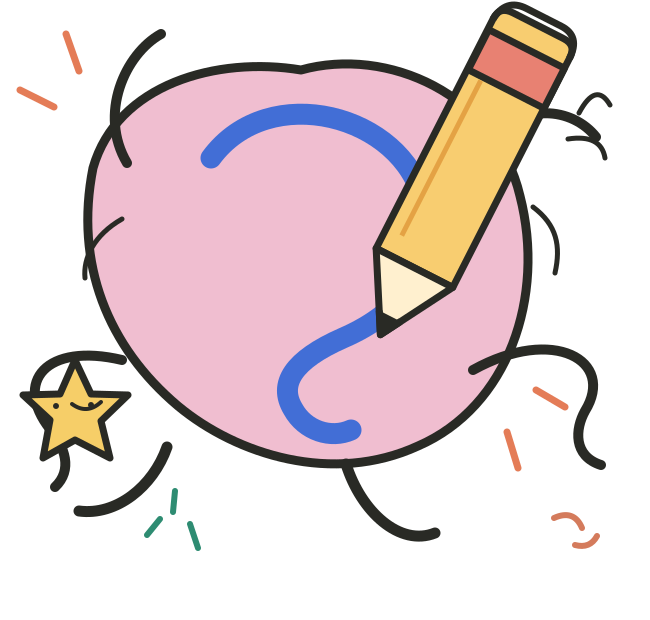

<p align="center">
  
</p>

<h1 align="center">SketchTogether</h1>

<p align="center">
  <strong>Make a little noise with your ideas.</strong><br />
  An illustrated, collaborative sketchbook for drawing, painting, vector design, and shared brainstorming.
</p>

<p align="center">
  <a href="#features">Features</a> ·
  <a href="#quick-start">Quick start</a> ·
  <a href="#cloud-rooms-and-realtime">Collaboration</a> ·
  <a href="#project-structure">Architecture</a> ·
  <a href="#deployment">Deployment</a> ·
  <a href="https://sketch-together-sx1z.vercel.app/">Previe live</a>
</p>

---

## What is SketchTogether?

SketchTogether is a browser-based creative workspace that combines a collaborative whiteboard with illustration and lightweight interface-design tools. Draw freehand, paint on raster layers, edit vector paths, arrange reusable elements, and invite other people into the same room.

Its *Endless Sketchpage* homepage and *Maker's Desk* editor have a paper-and-ink identity with original SVG illustrations, stickers, and custom tool artwork. The focus is on a canvas that feels creative without sacrificing precise editing controls.

> **Project status:** Actively developed (v1.0.2). This is still a work in progress. Some advanced operations are approximate, and production collaboration workflows are still being improved.

## Features

### Drawing and painting

- Freehand pencil, ink, marker, spray, and pressure-aware drawing tools.
- Adjustable stroke color, size, opacity, and brush settings.
- Transparent raster paint layers, pixel erasing, region fill, and supported blend modes.
- Editable text, sticky notes, geometric shapes, images, and hand-drawn stickers.
- Graph, dotted, ruled, blank, and chalkboard canvas backgrounds.
- Undo/redo, layer visibility and ordering, zoom, pan, and object inspection.

### Vector editing

- Continuous pen paths with connected straight segments and Bézier curves.
- On-canvas node and control-handle editing, with additional path/node operations.
- Grouping, ungrouping, duplication, grid snapping, and object snapping.
- Union, difference, intersection, exclusion, division, and fracture for supported closed shapes.
- Combine, break apart, split path, cut path, and approximate inset/outset operations.
- Linear and radial fills, plus four-corner raster-backed mesh-style color artwork.
- Smart straight/elbow connectors that follow attached objects.

**Vector limitations:** Complex curves are sampled into polygonal geometry for many Boolean and offset operations. Some tools accept only specific path types; open paths, raster layers, and compound geometries are not interchangeable. Keep an editable backup before applying destructive operations.

### Prototyping and reusable artwork

- Android, iPhone, tablet, and desktop-sized design frames.
- Reusable components saved in the browser and inserted as editable copies.
- Horizontal and vertical auto-layout for selected objects or groups.
- Object-level styling and layer controls.

These are **design and layout tools**, not a full interactive prototyping engine. Component instances are not yet linked to a global master, and frame templates do not generate production UI code.

### Shared rooms

- Local-only boards or private cloud rooms.
- Guest invitation links with owner/editor permissions.
- Live room presence, cursors, and reactions through **Supabase Realtime**.
- Redis-backed versioned object synchronization and conflict detection.
- **Protected** mode rejects stale conflicting edits; **Classic** mode uses last-write-wins behavior.
- Supported member-level changes to different objects within the same group can sync independently.
- Local recovery for pending edits and optional durable cloud backups.

Protected mode uses optimistic concurrency checks, **not a complete CRDT**. Simultaneously changing the same object or raster layer may require conflict resolution.

### Export and sharing

- Export as **PNG, JPEG, WebP, SVG, or editable board JSON**.
- Selected-object or whole-board output, image scaling, and supported transparency options.
- SVG export preserves supported vector elements; raster artwork remains embedded as images.
- Local board duplication, browsing, and private room sharing.

## Technology

| Area | Technology |
| --- | --- |
| Web app | Next.js 16 App Router, React 19, TypeScript |
| Drawing canvas | Fabric.js 6 |
| Vector Boolean operations | `polygon-clipping` |
| Realtime presence/events | Supabase Realtime |
| Active shared documents | Upstash Redis REST API |
| Optional durable backups | Supabase Storage + PostgreSQL |
| Styling | CSS, original SVG illustration assets |
| Tests / formatting | Node test runner, TypeScript, Prettier |

**Ably is not used in the current architecture.** Remove any old `AblyProvider` component, `@ably-labs/react-hooks` import, or `/api/ably` route left over from earlier versions.

## Quick start

### Requirements

- Node.js **20.9+** (Node.js 22 LTS is recommended).
- npm.
- Upstash Redis REST credentials for private cloud rooms.
- Optional Supabase project for live presence and durable backups.

### Run locally

```bash
# Clone the repo
# git clone https://github.com/Spgtx/Sketch_Together.git
# cd Sketch_Together

npm install
cp .env.example .env.local

# Add provider credentials to .env.local if using cloud rooms
npm run dev
```

Open **http://localhost:3000**.

If cloud services are not configured, use the explicit local-board option. Local boards are stored in the browser; they cannot generate cloud invitations until moved to a private cloud room.

### Useful commands

```bash
npm run dev          # Development server
npm test             # Project tests
npm run typecheck    # TypeScript verification
npm run build        # Production build
npm start            # Serve the production build
npm run format       # Format supported source files
npm run format:check # Check formatting
npm run redis:check  # Test Redis credentials/required commands
```


## Cloud rooms and realtime

Cloud rooms use several distinct services; a successful Realtime connection does **not** mean that cloud saves have succeeded.

```text
Editor in the browser
  ├─ Immediate canvas updates + local recovery
  ├─ Authenticated room API → Redis (authoritative live board)
  ├─ Supabase Realtime (presence and revision notifications)
  └─ Optional scheduled/manual backup
       ├─ Supabase Storage (compressed board snapshot)
       └─ PostgreSQL (backup metadata)
```

### Environment variables

Create `.env.local` :

```dotenv
# Required for private cloud rooms
UPSTASH_REDIS_REST_URL=
UPSTASH_REDIS_REST_TOKEN=

# Optional Supabase private Realtime transport
NEXT_PUBLIC_SUPABASE_URL=
NEXT_PUBLIC_SUPABASE_PUBLISHABLE_KEY=
SUPABASE_JWT_SECRET=

# Optional durable backups
SUPABASE_SERVICE_ROLE_KEY=
BACKUP_CRON_SECRET=

# Optional, only behind a trusted proxy that sanitizes client IP headers
# TRUST_PROXY_IP=true
# RATE_LIMIT_SALT=
```

### Backups

The current board is committed to Redis; Supabase backup is an additional operation. Owners can request a manual backup. A trusted scheduler can also send an authenticated `POST` request to `/api/maintenance/flush` with `Authorization: Bearer <BACKUP_CRON_SECRET>`.

A failed backup leaves the room marked for retry. **Automatic restore from a lost Redis database is not implemented**; do not clear Redis assuming Supabase will repopulate it.

## Using the editor

1. Start a new local or private cloud board, optionally from a template.
2. Choose a drawing, raster, vector, text, sticker, frame, or selection tool.
3. Use the Maker's Desk to adjust layers, nodes, colors, fills, components, and exports.
4. Hide or resize the tool panels when you need more canvas space; the panels remain separate from canvas zoom.
5. Share a private editor invitation when you want to collaborate.
6. Export editable JSON regularly, particularly before destructive geometry changes.

### Selected shortcuts

| Action | Shortcut |
| --- | --- |
| Selection | `V` |
| Continuous vector pen | `Q` |
| Node editing | `D` |
| Group / ungroup | `Ctrl + G` / `Ctrl + Shift + G` |
| Duplicate | `Ctrl + D` |
| Undo | `Ctrl + Z` |
| Finish an active path | `Enter` |
| Cancel an unfinished path | `Escape` |
| Pan without switching tools | Middle mouse button + drag |
| Zoom | `Ctrl` + mouse wheel |

Keyboard behavior may differ slightly on macOS and when focus is inside a text field.


## Security and limitations

- Room invitations are **bearer credentials**. Treat private invitation URLs like secrets.
- Owners control invitations and room policy; editors can change room artwork but do not gain ownership automatically.
- API rate limits, request-size limits, and Redis version checks reduce misuse, but they do not eliminate it.
- Realtime messages are notifications/presence; the authorized Redis endpoint is the source of live board state.
- Large raster drawings and embedded assets are subject to board and storage limits (the live cloud-board limit is currently approximately **4.5 MB**).
- Some Boolean operations, offsets, mesh fills, and group edits are intentionally limited or approximate.
- Guest links are not equivalent to user accounts, and the service is not yet hardened for unrestricted public usage.

## Roadmap

- More precise vector path operations and mesh editing.
- Better tablet input, advanced raster brushes, and larger/tiled painting surfaces.
- Linked design components, richer auto-layout, and interactive prototype flows.
- More granular multi-user editing and conflict resolution for complex objects.
- Account-based workspaces, team permissions, and stronger observability.

## Contributing

Issues, bug reports, reproducible test cases, and proposals for accessible drawing tools are welcome. When reporting a problem, include the affected feature, steps to reproduce, expected/actual behavior, browser information, and relevant console output **without secrets or private room links**.

The project's license should be specified in a separate `LICENSE` file before third parties assume rights to redistribute or modify the code.
